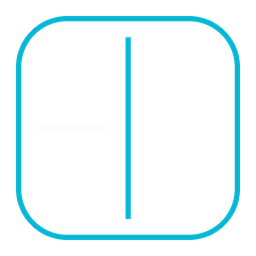

<div align="center" dir="rtl">
  
  <h1>DeepCode Studio — تطبيق سطح المكتب</h1>
  <p><strong>بيئة برمجة بالذكاء الاصطناعي تتقن العربية والكود.</strong></p>
  <p><a href="README.md">English</a> · العربية</p>
  <p>
    <a href="https://deepcode-2sfl.onrender.com/ar/download">التنزيل</a> ·
    <a href="https://deepcode-2sfl.onrender.com/ar/pricing">الأسعار</a> ·
    <a href="https://github.com/ALSRKAL/deepcode-desktop/releases">الإصدارات</a>
  </p>
</div>

<div dir="rtl">

DeepCode Studio مساحة عمل على سطح المكتب يقرأ فيها وكيل ذكاء اصطناعي مستودعك، ويخطط للتعديل،
ويعدّل الملفات كفروقات تراجعها بنفسك، ويشغّل الطرفية؛ بواجهة عربية أصلية (من اليمين لليسار)
وإنجليزية. النماذج تعمل عبر بوابة DeepCode بحساب واحد وخطة واحدة محسوبة الاستهلاك.

## المزايا

- **مساحة عمل الوكيل**: المهمة تصبح خطة، والخطة تصبح تعديلات تراجعها، بجانب طرفية حقيقية.
- **نماذج DeepCode**: قائمة واحدة تعرض النموذج الحقيقي خلف كل اسم (DeepSeek وGLM وQwen وKimi
  وgpt-oss)، مع مستويات التفكير، ونوافذ سياق دقيقة، وضغط تلقائي للسياق عند امتلائه.
- **الخطة والاستهلاك داخل التطبيق**: الخطة والرصيد المستخدم والمتبقي، وتجربة مجانية 24 ساعة
  للحسابات الجديدة، متزامنة مع الموقع.
- **التحكم من الجوال**: امسح رمز QR لمتابعة المهام وتوجيهها من هاتفك، من أي شبكة (عبر خادم
  DeepCode) أو على نفس شبكة Wi-Fi.
- **مهارات وإضافات جاهزة**: Impeccable لتصميم الواجهات، تصميم الواجهات الأمامية، أفضل ممارسات
  React وReact Native، بناء خوادم MCP، اختبار تطبيقات الويب، Superpowers، المستندات (Word وExcel
  وPowerPoint وPDF)، وأدوات المتصفح وAndroid/iOS. خوادم MCP مدعومة.
- **تحديثات تلقائية** على Windows وmacOS وLinux، دائماً إلى أحدث إصدار مباشرة.

## التثبيت

حمّل المثبّت لنظامك من [صفحة التنزيل](https://deepcode-2sfl.onrender.com/ar/download) أو من
[آخر إصدار](https://github.com/ALSRKAL/deepcode-desktop/releases/latest):

| النظام | الملفات |
| --- | --- |
| Windows 10/11 (x64) | `.exe` |
| macOS (Apple silicon وIntel) | `.dmg` و`.zip` |
| Linux (x64 وarm64) | `.AppImage` و`.deb` و`.rpm` |

تثبيت بأمر واحد:

</div>

```bash
curl -fsSL https://deepcode-2sfl.onrender.com/install.sh | sh
```

```powershell
irm https://deepcode-2sfl.onrender.com/install.ps1 | iex
```

<div dir="rtl">

بعدها افتح التطبيق واضغط **تسجيل الدخول** (يفتح الموقع لربط حسابك) ثم افتح مجلد مشروعك.

## البناء من المصدر

المتطلبات: Node 24 وpnpm 10.

</div>

```bash
pnpm install
pnpm typecheck
pnpm --filter @zcode/desktop dev
```

<div dir="rtl">

نسخ الإصدار لكل الأنظمة تُبنى تلقائياً عبر سير العمل `DeepCode Desktop` عند رفع وسم `v*`.

## الترخيص والشكر

تطبيق DeepCode Studio لسطح المكتب مرخّص بموجب [Apache License 2.0](LICENSE)، ومبني على
[ZCodium](https://github.com/axiom-desu/ZCodium) (نسخة مجتمعية من ZCode)؛ ملف README الأصلي
محفوظ في [docs/upstream](docs/upstream/README.en.md). المكوّنات والمهارات الخارجية تحتفظ
بتراخيصها: راجع [NOTICE.md](NOTICE.md) و[THIRD-PARTY-NOTICES.md](THIRD-PARTY-NOTICES.md)
وملف `NOTICE.md` لكل إضافة.

</div>
