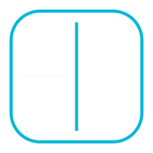

<div align="center">
  
  <h1>DeepCode Studio — Desktop</h1>
  <p><strong>An AI coding IDE fluent in Arabic and in code.</strong></p>
  <p>English · <a href="README.ar.md">العربية</a></p>
  <p>
    <a href="https://deepcode-2sfl.onrender.com/en/download">Download</a> ·
    <a href="https://deepcode-2sfl.onrender.com/en/pricing">Pricing</a> ·
    <a href="https://github.com/ALSRKAL/deepcode-desktop/releases">Releases</a>
  </p>
</div>

DeepCode Studio is a desktop workspace where an AI agent reads your repository, plans a
change, edits files as reviewable diffs and runs the terminal, with a fully native Arabic
(right-to-left) and English interface. Models are served through the DeepCode gateway with
one account and one metered plan.

## Features

- **Agent workspace**: tasks become plans, plans become diffs you review, next to a real terminal.
- **DeepCode models**: one menu with the real model behind each name (DeepSeek, GLM, Qwen,
  Kimi, gpt-oss), effort levels, exact context windows, automatic context compaction.
- **Plans and usage in the app**: plan, credits used and remaining, and the 24-hour free
  trial for new accounts, synced with the website.
- **Phone remote control**: scan a QR code to follow and drive tasks from your phone,
  from any network (through the DeepCode server) or on the same Wi-Fi.
- **Skills and plugins built in**: Impeccable UI design, frontend design, React and React
  Native best practices, MCP server building, web app testing, Superpowers, documents
  (Word, Excel, PowerPoint, PDF), browser and Android/iOS tooling. MCP servers are supported.
- **Automatic updates** on Windows, macOS and Linux, always straight to the newest release.

## Install

Get the installer for your system from the [download page](https://deepcode-2sfl.onrender.com/en/download)
or the [latest release](https://github.com/ALSRKAL/deepcode-desktop/releases/latest):

| System | Files |
| --- | --- |
| Windows 10/11 (x64) | `.exe` |
| macOS (Apple silicon, Intel) | `.dmg`, `.zip` |
| Linux (x64, arm64) | `.AppImage`, `.deb`, `.rpm` |

One-line install:

```bash
curl -fsSL https://deepcode-2sfl.onrender.com/install.sh | sh
```

```powershell
irm https://deepcode-2sfl.onrender.com/install.ps1 | iex
```

Then open the app, press **Sign in** (it opens the website to connect your account) and
open a project folder.

## Build from source

Requirements: Node 24, pnpm 10.

```bash
pnpm install
pnpm typecheck
pnpm --filter @zcode/desktop dev      # run the desktop app in development
```

Release builds for every platform are produced by the `DeepCode Desktop` workflow when a
`v*` tag is pushed (see `.github/workflows/`).

## Repository layout

| Path | What |
| --- | --- |
| `packages/desktop` | Electron main process, packaging, auto-update |
| `packages/ui`, `packages/web` | Shared UI, web workbench and the phone remote-control page |
| `packages/deepcode` | DeepCode account, sign-in and subscription sync |
| `packages/relay` | Phone remote-control relay (hosted on the DeepCode server) |
| `apps/zcode-cli` | Agent CLI and runtime, built-in plugins and skills |
| `config/provider` | Built-in model provider configuration |

## License and credits

DeepCode Studio desktop is licensed under the [Apache License 2.0](LICENSE).
It is based on [ZCodium](https://github.com/axiom-desu/ZCodium), a community build of ZCode;
the original upstream README is kept in [docs/upstream](docs/upstream/README.en.md).
Third-party components and bundled skills keep their own licenses: see
[NOTICE.md](NOTICE.md), [THIRD-PARTY-NOTICES.md](THIRD-PARTY-NOTICES.md) and each plugin's
`NOTICE.md`.
